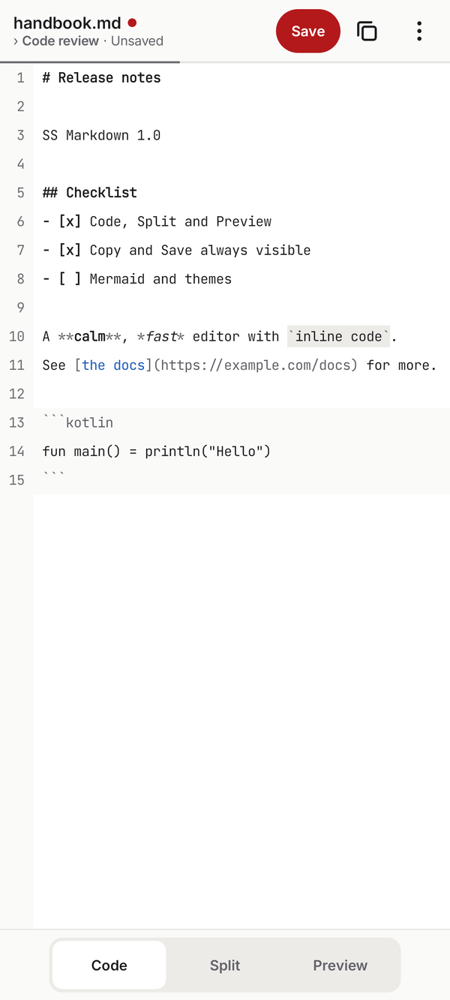
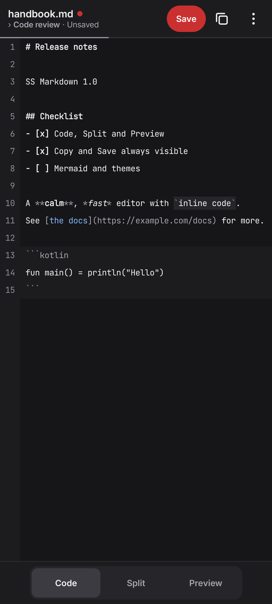
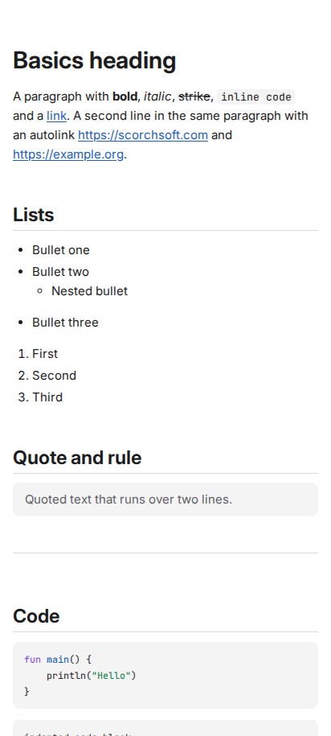
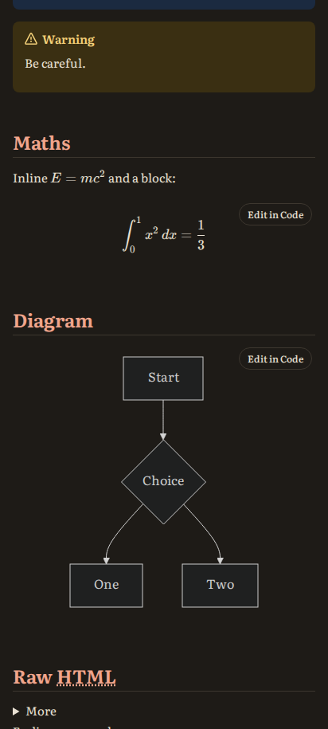
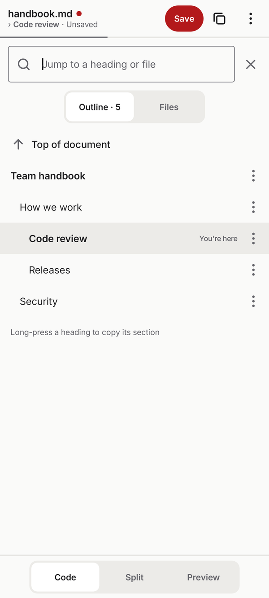
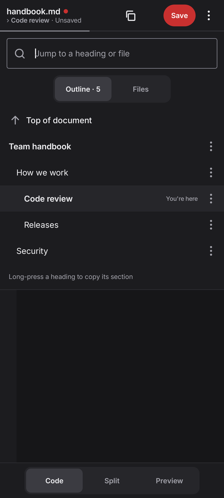
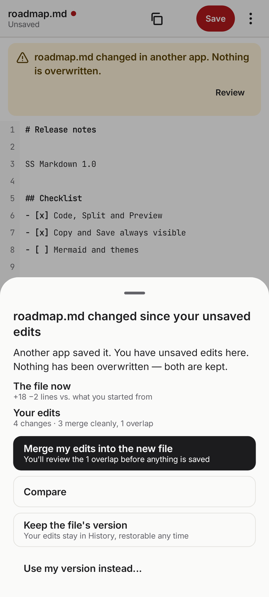
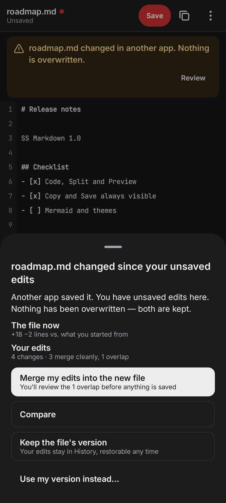
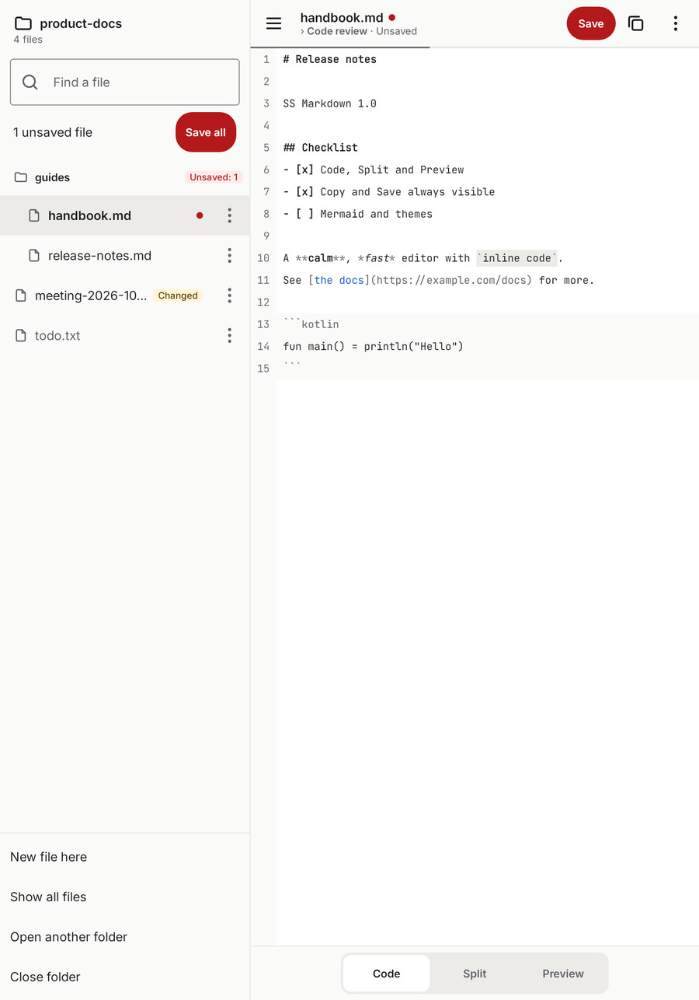
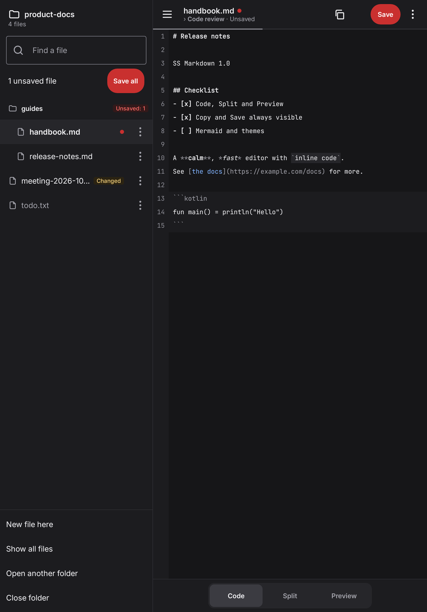

<p align="center">
  
</p>

<h1 align="center">SS Markdown</h1>

<p align="center">
  A calm, fast Markdown editor for Android that never loses your work.<br>
  Open source, offline, with no accounts and no ads. Built by
  <a href="https://www.scorchsoft.com">Scorchsoft</a>.
</p>

<p align="center">
  <a href="https://play.google.com/store/apps/details?id=com.scorchsoft.ssmarkdown"><strong>Get it on Google Play</strong></a>
</p>

---

> **Status:** feature-complete for its first release candidate, pending
> on-device verification. Every feature below is built and tested on the
> host and in CI; the performance budgets still need numbers from real
> phones. See the [roadmap](docs/roadmap.md).

## Why SS Markdown

- **Big files feel like small ones.** Your text lives in a piece tree,
  the same kind of structure VS Code uses. Typing never shuffles
  megabytes of text around, and only what's on screen is drawn.
- **You don't lose work.** A checksummed recovery journal, verified
  saves, and version history stored as snapshots plus diffs. If another
  app changes your file, nothing is overwritten without asking.
- **Calm by design.** Two bars. Copy and Save are always visible, and
  everything else appears only when it applies.
- **Edit the way you think.** Switch between Code, Split and Preview,
  and type straight into the formatted view, tables included, without
  your hand-written Markdown being reformatted.
- **Plain files, your files.** Open and save `.md` files in place from
  any app, or work across a whole folder. Nothing is locked inside the
  app.

How it works under the hood: [docs/how-it-works.md](docs/how-it-works.md)

## Features

- Code / Split / Preview with position kept in sync, plus a pinch zoom
  that reflows the text.
- GitHub-flavoured Markdown, footnotes, alerts, front matter, KaTeX
  maths and Mermaid diagrams (long-press to save as PNG or SVG; export
  all images at once).
- Tap-to-edit in Preview and a proper table editor.
- Navigator: an outline, a quick switcher and drafts, opened by tapping
  the title.
- Version history with compare, restore and pinning; recovery after a
  crash.
- Folder mode with Save all, and share text in from any app: your recent
  files appear in Android's share sheet, so any of them is two taps away.
  (Their names show there and in the launcher's menu; Settings → Sharing
  turns that off.)
- Light and dark themes following the system, built-in preview themes,
  custom themes and Google Fonts.
- Export to PDF with proper print typography (A4 or Letter).

## Screenshots

| | Light | Dark |
|---|---|---|
| **Editor.** Two bars at rest; unsaved is a red dot, the word "Unsaved" and a red Save. |  |  |
| **Preview.** The real page render in the Clean and Reader themes, with maths and Mermaid. |  |  |
| **Navigator.** Tap the title: outline, files and drafts, with "You're here". |  |  |
| **Another app changed the file.** Nothing is overwritten; merge, compare or keep either version. |  |  |
| **Tablet.** Folder panel docked, with Save all and per-file state. |  |  |

Every image is generated, not drawn: the app screens by the Robolectric
screenshot harness and the Preview by the page's own Playwright tests.
CI renders a fresh set of every screen and sheet on each run. How to
refresh these is in [`docs/screenshots/`](docs/screenshots/README.md).

## Building

Requirements: JDK 21, Android SDK (API 36) and Gradle 8.14.x (AGP 8.13
does not run on Gradle 9). There is no Gradle wrapper, on purpose
([ADR 0002](docs/adr/0002-no-gradle-wrapper.md)). Run Gradle from the
repository root:

```sh
export ANDROID_HOME=/path/to/android-sdk
gradle -p apps/android check                 # unit tests, coverage gate, lint, ktlint, detekt, module graph
gradle -p apps/android :app:assembleDebug    # debug APK
gradle -p apps/android -Pssmarkdown.minifyDebug=true :app:assembleDebug   # optimised, debug-signed APK
gradle -p apps/android -Pssmarkdown.screenshots=true :app:testDebugUnitTest --tests '*ScreenshotTest*'
```

The Preview's web bundle is committed, so Gradle never needs Node. To
change it you need Node 22 (see `apps/android/feature/preview/web/.nvmrc`).

The contributor map, with every module, every command and the known
traps, is the **Android working map**,
[`apps/android/CLAUDE.md`](apps/android/CLAUDE.md) (named for the tool
that also reads it; it is written for people). More detail is in
[`apps/android/README.md`](apps/android/README.md) and
[CONTRIBUTING.md](CONTRIBUTING.md).

Rough times on a 4-core machine (CI's runners): a `check` that runs
every test takes about 11 minutes and `:app:assembleDebug` about 4–5; a
first run adds a few minutes of downloads. Re-runs served from the Gradle
build cache take 1–2 minutes.

## Documentation

| | |
|---|---|
| [Product journey](docs/product-journey.md) | Vision, principles and every decision so far |
| [UX spec](docs/ux-spec.md) | What each control does and when it appears |
| [How it works](docs/how-it-works.md) | The text engine, never-lose-work, where history lives |
| [Robustness](docs/robustness.md) | The never-lose-work and large-file contract |
| [Quality bar](docs/quality-bar.md) and [rubric](docs/rubric.md) | The definition of good, and how it's scored |
| [Engineering](docs/engineering.md) | Code standards and architecture |
| [Decision records](docs/adr/) | Why the big structural choices are what they are |
| [Roadmap](docs/roadmap.md) | Build iterations |

## Contributing

Issues and pull requests are welcome. Please read
[CONTRIBUTING.md](CONTRIBUTING.md) and
[docs/engineering.md](docs/engineering.md) first: the code is held to a
high bar, and every bug fix starts with a failing test. Questions and bug
reports go to GitHub issues: see [SUPPORT.md](SUPPORT.md). Report security
issues privately, as described in [SECURITY.md](SECURITY.md). Everyone
taking part follows the [Code of Conduct](CODE_OF_CONDUCT.md). Changes
are listed in the [changelog](CHANGELOG.md).

## Disclaimer

SS Markdown is provided **"as is", without warranty of any kind**,
express or implied. The authors and Scorchsoft accept no liability for
any loss or damage arising from its use, including loss of data.
Although the app is built to protect your work, please keep your own
backups of anything important. The full terms are in sections 7 and 8
of the [Apache License 2.0](LICENSE).

## Licence

Copyright 2026 [Scorchsoft Ltd](https://www.scorchsoft.com). Licensed
under the [Apache License 2.0](LICENSE). Third-party attributions are
in [NOTICE](NOTICE).

The licence covers the code only. **Scorchsoft** is a trademark of
Scorchsoft Ltd. The Scorchsoft name and logos, and the SS Markdown name,
logo and app icon, are not open source. A fork must use its own
name and icon: see [TRADEMARKS.md](TRADEMARKS.md).

---

<p align="center">
  Made by <a href="https://www.scorchsoft.com">Scorchsoft</a>, an app
  and AI development studio.
</p>
