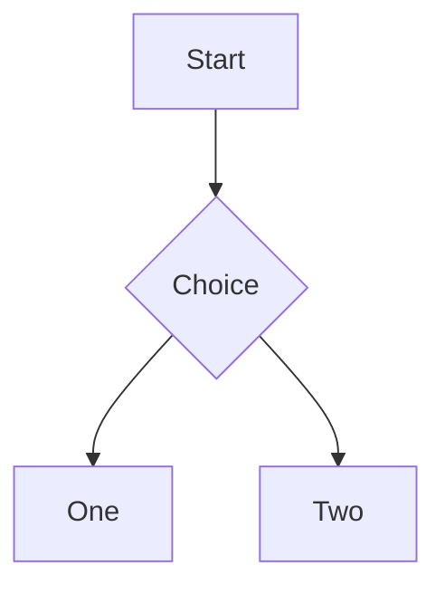

# Extended syntax

[[toc]]

## Footnotes and references

Here is a footnote reference[^1] and another[^note]. A [reference link][ref] too.

[ref]: https://example.com/ref "Reference"

[^1]: The first footnote.

[^note]: A named footnote.

## Inline extensions

H~2~O and E=mc^2^ with ==marked text== and :smile: and :rocket:.

*[HTML]: Hyper Text Markup Language

The HTML abbreviation is expanded.

## Definition list

Term
: Definition of the term.

## Tasks

- [ ] Open task
- [x] Done task

## Alerts

> [!NOTE]
> Useful information.

> [!WARNING]
> Be careful.

## Maths

Inline $E = mc^2$ and a block:

$$
\int_0^1 x^2\,dx = \frac{1}{3}
$$

## Diagram

## Raw HTML

More

Hidden text.

Ending paragraph.
