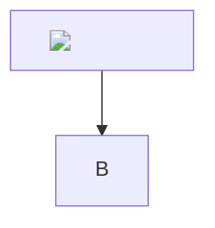

# Hostile input

<svg onload="window.__pwned = 'svg'"><circle r="5"/></svg>

<iframe src="https://example.com"></iframe>

<object data="x.swf"></object><embed src="x.swf">

<form action="https://evil.example"><input name="q" type="text"><button>Go</button></form>

<meta http-equiv="refresh" content="0;url=https://evil.example">

<a href="javascript:window.__pwned='a'">raw js link</a>

<a href="jav&#x61;script:window.__pwned='entity'">entity js link</a>

<math><mtext><table><mglyph></mglyph></table></mtext></math>

forged source map

[markdown js link](javascript:window.__pwned='md')

[data link](data:text/html;base64,PHNjcmlwdD5hbGVydCgxKTwvc2NyaXB0Pg==)

[file link](file:///etc/passwd) [content link](content://com.example/secret) [intent link](intent://scan#Intent;end)

$\href{javascript:alert(1)}{click}$ and $\htmlClass{x}{y}$

$$
\def\a{\a\a}\a
$$

Text after everything is still here.
